# VLM-Forge

**Fine-tune [Moondream 3.1](https://huggingface.co/moondream/moondream3.1-9B-A2B) locally for your own scene — detect, point, query and caption — without writing labels by hand.**

[](CHANGELOG.md) [](LICENSE)  

An AI teacher (Qwen3-VL) looks at your photos and writes the questions and the answers, Moondream answers the same questions, the two are compared, and you only check what they disagree on — one question at a time, keyboard first. Confirmed answers become a dataset; one button trains a LoRA adapter; the adapter is scored against the untouched base on held-out images and exported in the exact layout Moondream's **Photon** runtime (kestrel) loads on a **Jetson Orin**.

As far as we know this is the only local trainer for Moondream 3.1: the official repo's `lora.py` only downloads cloud-trained variants, and Moondream's cloud fine-tuning closes on 2026-11-13.

Built for factory / warehouse CCTV (是否有值班人員、有沒有戴安全帽、出口有沒有被擋…), but nothing in it is tied to that domain.

> Moondream 3.1 本機微調工具：AI 導師先標、你只看不一致的題、一鍵 LoRA 訓練、在 held-out 考卷上和 base 比分、匯出到 Orin。決議在 [GOALS.md](GOALS.md)，介面規格在 [docs/ui-spec.md](docs/ui-spec.md)，版本紀錄在 [CHANGELOG.md](CHANGELOG.md)。

## Why

- **A real 3.1 port you can backprop through.** Pure PyTorch: vision tower, text MoE (64 experts, FP8 dequantised), region head, LoRA on the dense layers and every expert. Base scores match the official runtime on three held-out suites.
- **Adapters that run on the edge.** LoRA goes on the text MLPs only, in kestrel's `lora_state_dict` layout, so the adapter loads into Photon unchanged. The region head is an opt-in extra (Forge-only).
- **Labelling is the bottleneck, not training.** Teacher → student → compare, then triage per question: on a 120-image warehouse set the teacher wrote 2 845 questions, 1 344 agreed and passed automatically, and a human looks at 1 469.

## The three steps

Every page has the same shape: content on the left, an action column on the right with a tool row (「? 快捷鍵」) and then the page's one orange button. Orange always means "do this next" (or your answer on the canvas); everything else is neutral. Sub-views open from the content and go back with `←` or `Esc`. Light and dark themes; on narrow windows the primary action pins to the bottom.

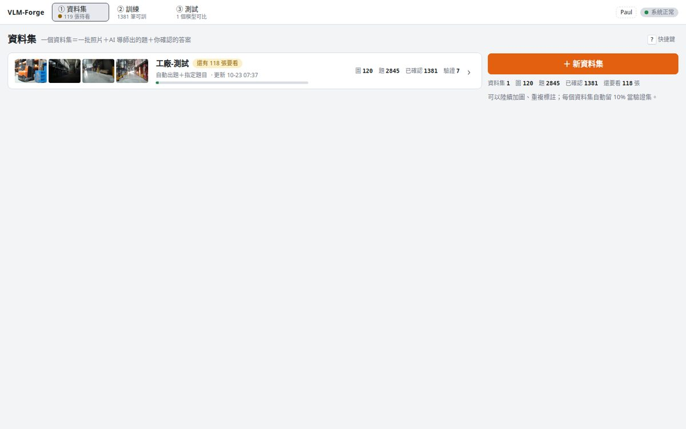

### ① 資料集 — photos in, confirmed answers out

Drop photos, a zip or a folder path. The grid shows how many questions on each image still disagree; the orange button is always the next thing to do; settings, export and delete live in the action column, the last pinned to its bottom. The teacher's settings live in the action column: automatic questions (objects, counts, yes/no, attributes, inspection checks, a caption), fixed prompts you write once (`detect: person, helmet` / `query: Is anyone without a helmet?`), or both. 10 % of the images become the dataset's validation split.

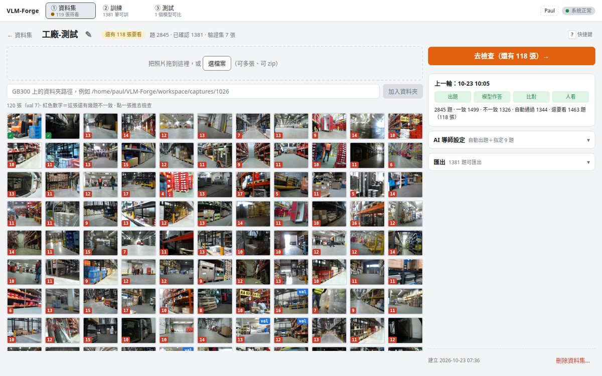

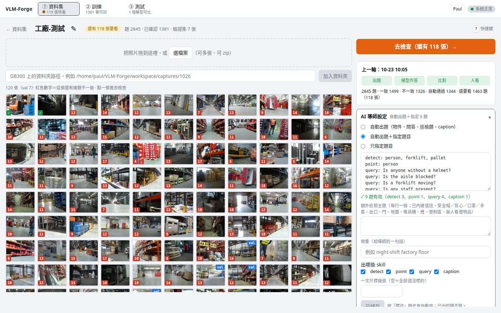

**Review** — one image, one question at a time, disagreements first, with this image's question list beside it.

| Question | What you do |
| --- | --- |
| yes / no | `Y` or `N` — saves and moves on |
| count | type the digits or `↑↓`, `Enter` |
| detect | drag boxes, `Tab` / arrows / `Delete`; `3` adds the pre-label boxes you are missing; saving can save the matching point question too (`P`) |
| point | click to add, drag to move; `3` puts a point in every pre-label box that has none; `Backspace` removes the last |
| caption | edit the text; phrases the judge could not find in the image are chips you can delete |

`Enter` saves, `1` / `2` take the teacher's or the model's answer, `Shift+Enter` saves the rest of the image, `D` discards, `S` skips. The canvas zooms to the boxes in question (`F` for the whole image) with its controls floating over the image, pre-label boxes turn green once your answer covers them, and a key bar at the bottom shows what works right now — so buttons stay few and unlabelled.

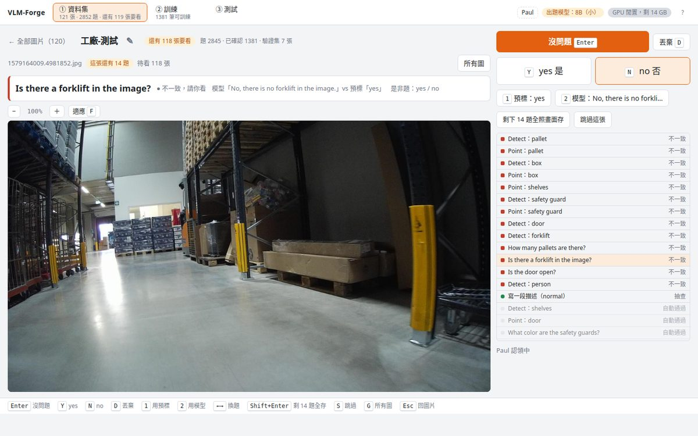

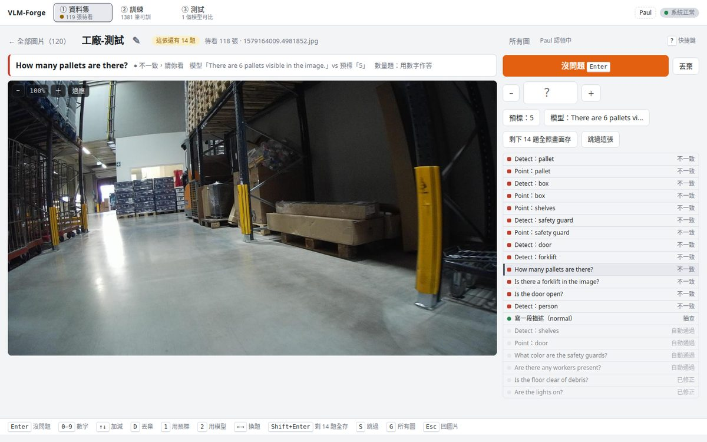

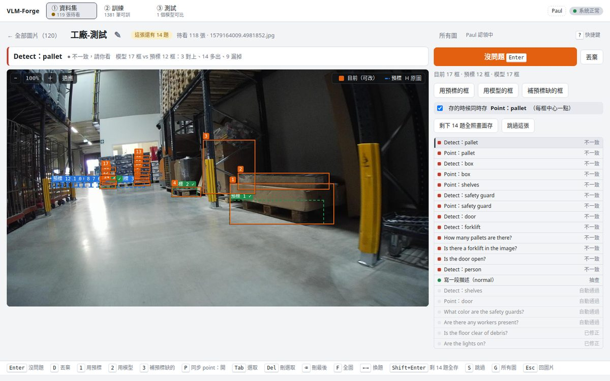

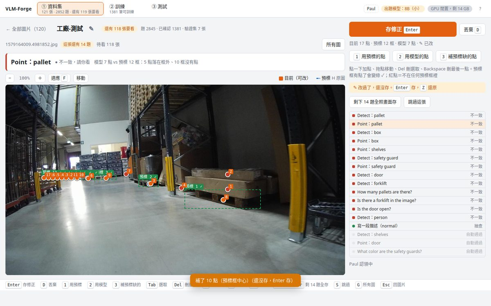

### ② 訓練 — pick, check, one button

Pick datasets as cards (confirmed questions, images, a bar per skill), keep the defaults (steps from the number of confirmed images, lr 2e-4, rank 16), and read the summary next to the button: what will be trained, for how long, and which exams score it. The run trains, scores itself on every held-out suite and each dataset's validation split, and gates against base.

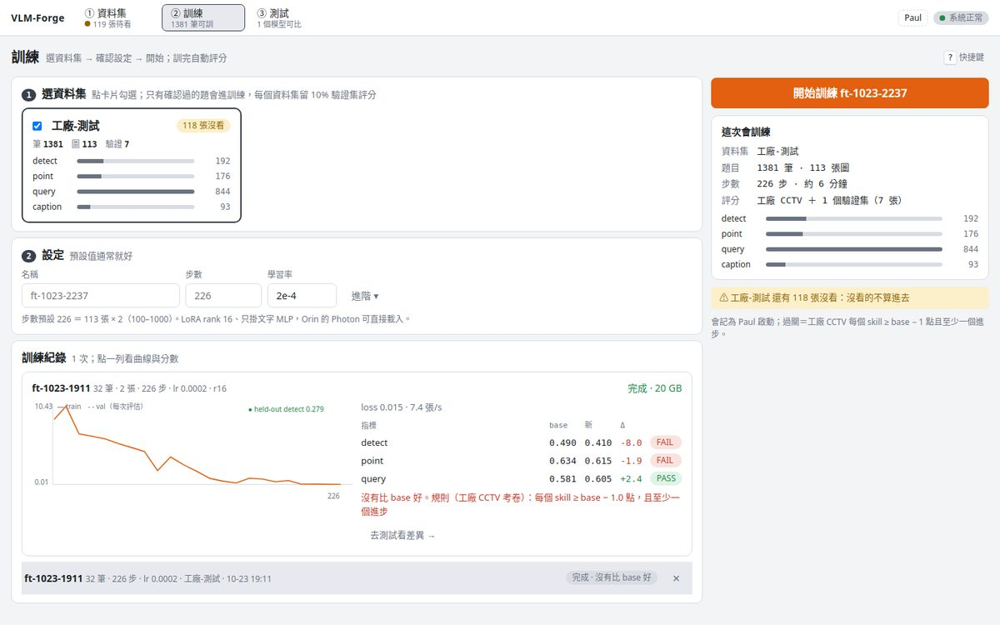

### ③ 測試 — base vs your model

The target exam (factory CCTV) leads as a full-width card with the gate verdict; validation splits and reference suites sit below; every cell shows its delta, every model column has one 「看差異」. 看差異 walks through the items that changed, both canvases zooming together. 試一張 runs base and the adapter on any image with factory quick prompts. The Orin bundle is a section in the action column: `adapter.pt`, a loader, a latency script.

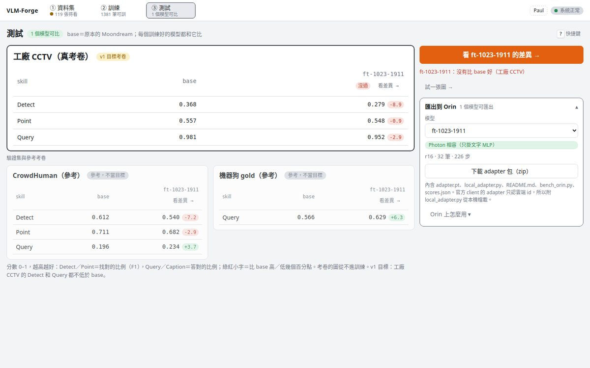

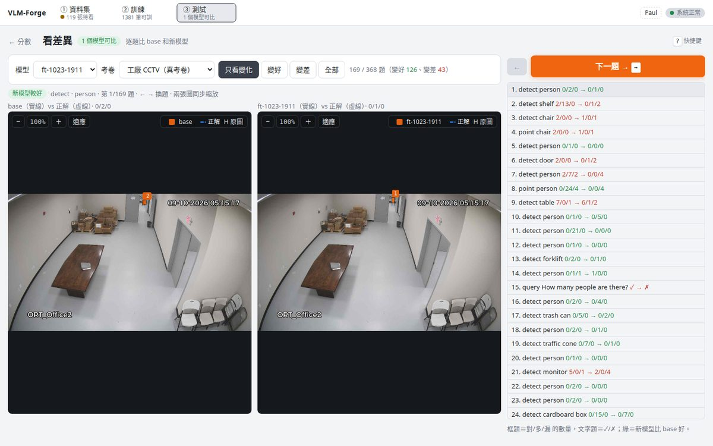

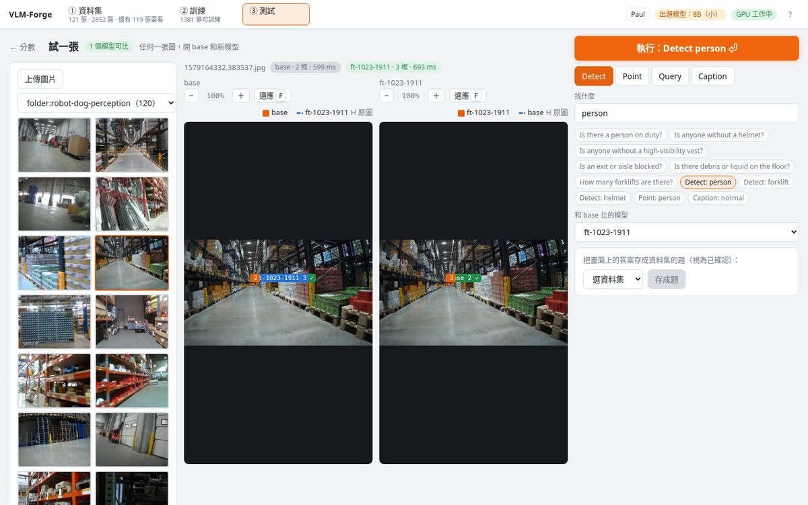

## Quick start

Needs one NVIDIA GPU (24 GB for Moondream; the teacher needs another ~22 GB for Qwen3-VL-8B or ~70 GB for Qwen3-VL-32B), Python 3.12, Node 20+, [`uv`](https://docs.astral.sh/uv/).

```bash
git clone https://github.com/PSheon/VLM-Forge && cd VLM-Forge
uv sync --extra ui --extra judge

# weights (public, no login) + tokenizer
hf download moondream/moondream3.1-9B-A2B model.safetensors --local-dir model-cache/moondream31/weights
hf download moondream/starmie-v1 --local-dir model-cache/moondream31/tokenizer

# the teacher / judge: either one, or both (the 32B is used when it fits)
hf download Qwen/Qwen3-VL-8B-Instruct  --local-dir model-cache/judge-8b
# ln -s /path/to/Qwen3-VL-32B-Instruct model-cache/judge

(cd web && npm install && npm run build)
uv run forge serve --port 8796          # open http://localhost:8796
```

Held-out suites are optional: without them the test page scores only your datasets' validation splits. `forge manifests` builds them from a Data Core release if you have one. Labelling progress lives in memory; if the server restarts mid-batch, the dataset page offers 「接著跑」 to resume.

## CLI

Everything the UI does is also a command:

```bash
forge eval heldout-cctv [--adapter runs/x/x.pt]   # score base or an adapter → eval-*.json
forge train configs/detect-cctv-v1.yaml           # LoRA → runs/<name>/<name>.pt
forge gate --base runs/baselines/base-heldout-cctv.json --adapter runs/x/eval-x-heldout-cctv.json --skill multi
forge export NAME --queue 3                       # reviewed rows → workspace/export/NAME.jsonl
forge capture --out workspace/captures/<date> --url 'rtsp://…'   # frames from an RTSP camera
```

Adapter file: `{"lora_state_dict", "rank", "alpha", "region_head"?}` — keys `text_lora.dense.{i}.{up_a,up_b,down_a,down_b}` and `text_lora.moe.{j}.*`, alpha folded into B, rank a multiple of 8. On the Orin: `from local_adapter import Tuned; Tuned("adapter.pt").detect(img, "person")` (the bundle ships the loader; the `moondream` client only knows cloud adapter ids).

## Layout

| Path | What |
| --- | --- |
| `src/vlmforge/model/` | Moondream 3.1 in plain PyTorch: vision, text (MoE, FP8 experts dequantised), region, `TextLoRA`, `RegionHead` |
| `src/vlmforge/{data,evaluate,gate,train}.py` | manifests and mixtures, per-skill metrics, the gate, the LoRA trainer with self-distillation replay |
| `src/vlmforge/{autogen,judge}.py` | teacher prompts and parsing, agreement rules, the Qwen3-VL judge |
| `src/vlmforge/server/` | FastAPI: workspace (SQLite), datasets, per-question triage, one GPU worker, the training pipeline, the Orin bundle |
| `web/` | Vite + React + TypeScript UI; `docs/ui-spec.md` is its spec, `web/src/components/ui.tsx` the shared pieces |
| `tests/` | CPU-only unit tests (`uv run pytest`) |
| `web/e2e/smoke.mjs` | UI smoke test against a running server (`cd web && npm run e2e`): one primary button per view, level title / tool rows, no tab bars, no console errors, Esc goes back — in light, dark and 1024 px |
| `model-cache/`, `runs/`, `workspace/`, `data/` | not in git |

Branches: `feat/* → dev → main`. `ruff` for lint and format, `uv` for the environment. UI changes run `npm run e2e` (read-only: it never saves an answer or runs inference) before they merge. Each version is tagged and listed in [CHANGELOG.md](CHANGELOG.md).

## Status

v0.3.0 (2026-10-23), working end to end on one GB300: a 120-image warehouse set → 2 845 questions → per-question review → train → score → diff → Orin bundle. The port's base scores match the official runtime on three held-out suites; the same trainer, on a larger in-domain set, raised CCTV detect from 0.37 to 0.46 (text-MLP LoRA only). Not yet verified on real Orin hardware.

## License

MIT for this repository. Moondream 3.1 weights are under their own [license](https://huggingface.co/moondream/moondream3.1-9B-A2B); Qwen3-VL under Apache-2.0.
