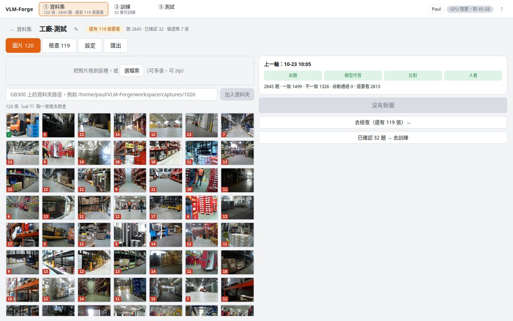
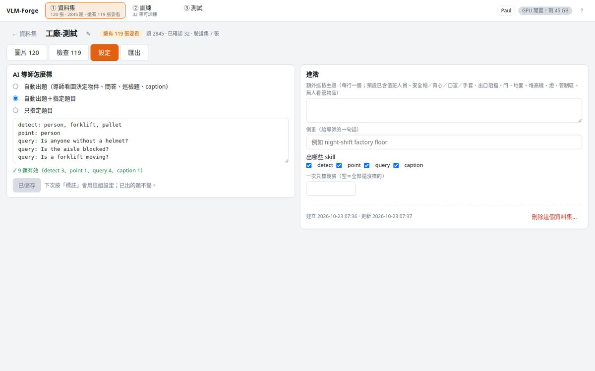
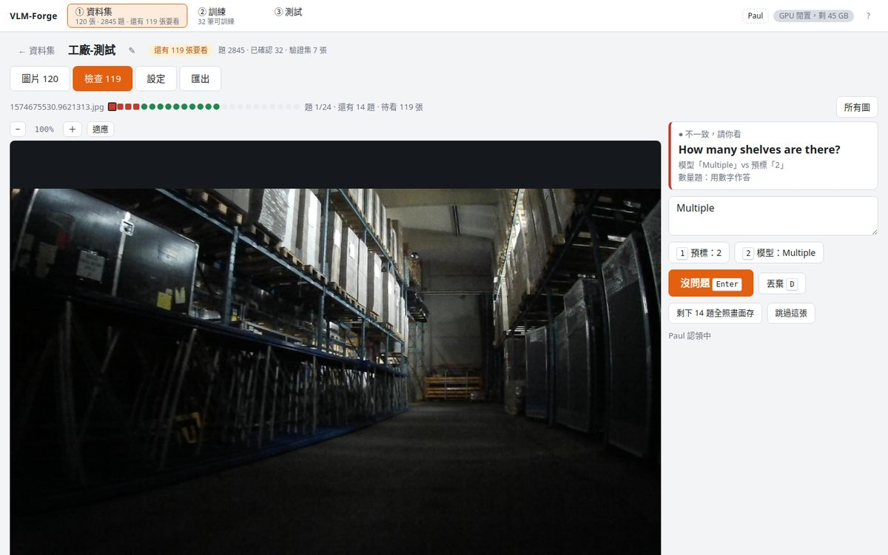
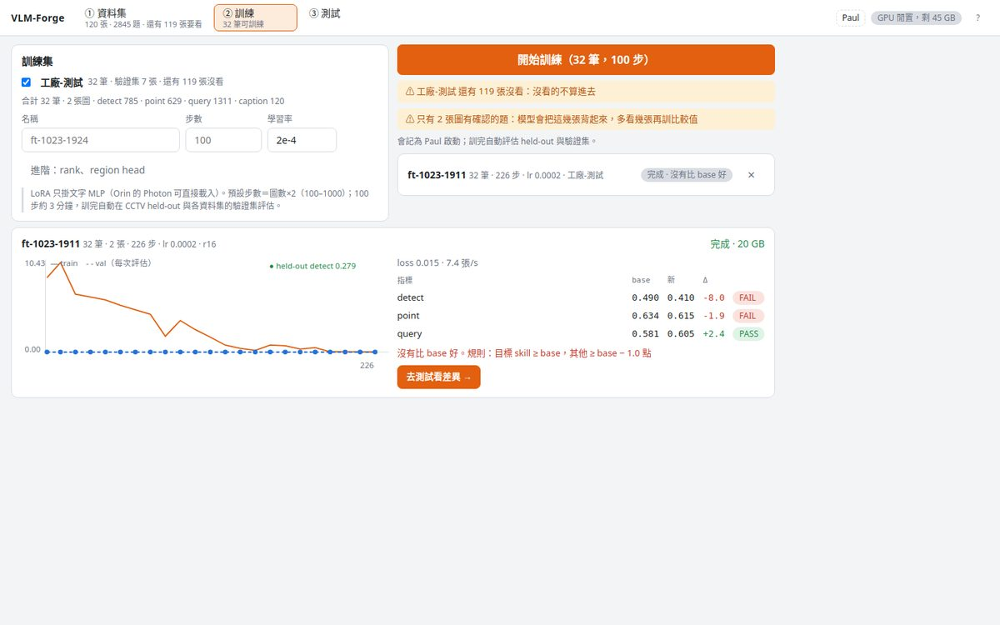
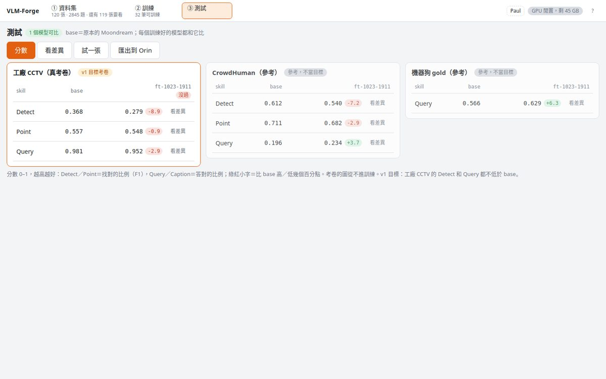
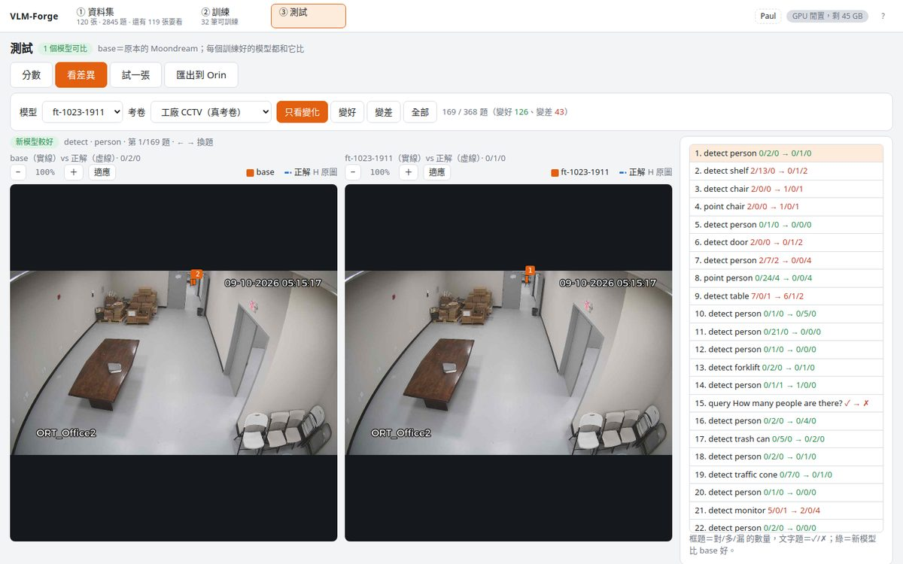
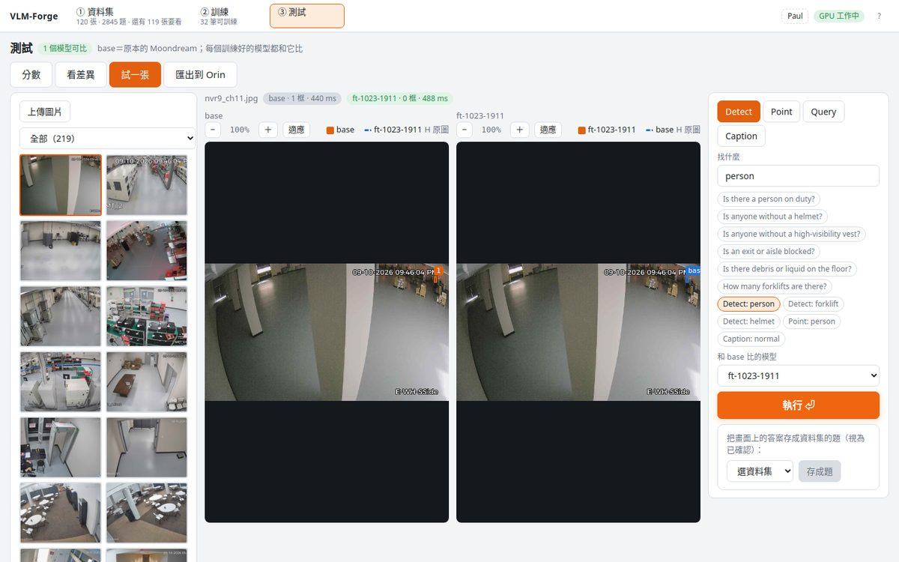

# VLM-Forge

**Fine-tune [Moondream 3.1](https://huggingface.co/moondream/moondream3.1-9B-A2B) for your own scene — detect, point, query and caption — without writing labels by hand.**

An AI teacher (Qwen3-VL) looks at your photos, writes the questions and the answers, Moondream answers the same questions, the two are compared, and you only check what they disagree on. Confirmed answers become a dataset; one button trains a LoRA adapter; the adapter is scored against the untouched base on held-out images and exported in the exact layout Moondream's **Photon** runtime (kestrel) loads on a **Jetson Orin**.

Built for factory / warehouse CCTV (是否有值班人員、有沒有戴安全帽、出口有沒有被擋…), but nothing in it is tied to that domain.

> Moondream 3.1 微調工具：AI 導師先標、你只看不一致的題、一鍵 LoRA 訓練、在 held-out 考卷上和 base 比分、匯出到 Orin。決議全部在 [GOALS.md](GOALS.md)，介面規格在 [docs/ui-spec.md](docs/ui-spec.md)。

## Why

- Moondream never shipped local training code and its cloud fine-tuning closes on 2026-11-13. VLM-Forge is a pure-PyTorch port of 3.1 (vision tower, text MoE, region head, LoRA) whose base scores match the official runtime, plus a trainer for it.
- LoRA goes on the text MLPs only (dense layers + every MoE expert), the same `lora_state_dict` layout kestrel reads — so what you train here runs on Photon unchanged. The region head is an opt-in extra (Forge-only).
- Labelling is the bottleneck, not training. The teacher → student → compare loop means a 120-image batch is ~2 800 questions of which you look at the disagreements, one question at a time, keyboard only.

## The three steps

### ① 資料集 — photos in, confirmed answers out

Drop photos, a zip or a folder path. Pick how the teacher works: automatic questions (objects, counts, yes/no, attributes, inspection checks, a caption), fixed prompts you write once (`detect: person, helmet` / `query: Is anyone without a helmet?`), or both. 10 % of the images are held back as the dataset's validation split.





Review lives inside the dataset: one image, one question at a time, disagreements first. `Enter` saves, `1`/`2` take the teacher's or the model's answer, `Shift+Enter` saves the rest of the image, `D` discards. Boxes and points are edited on the canvas (drag, resize, `Tab`, arrows, `Delete`); captions show the phrases the judge could not find in the image as removable chips.



### ② 訓練 — one button

Tick the datasets, keep the defaults (steps from the number of confirmed images, lr 2e-4, rank 16). Blockers are red and stop you; warnings are yellow and do not. The run trains, then scores itself on every held-out suite and each dataset's validation split, and gates against base.



### ③ 測試 — base vs your model

One card per exam: the target suite (factory CCTV) is marked, references are dimmed, every cell shows the score and the delta. 看差異 walks through the items that changed, side by side with the ground truth. 試一張 runs base and the adapter on any image with quick inspection prompts. 匯出到 Orin downloads `adapter.pt` with a loader and a latency script.







## Quick start

Needs one NVIDIA GPU (24 GB for Moondream; the teacher needs another ~22 GB for Qwen3-VL-8B or ~70 GB for Qwen3-VL-32B), Python 3.12, Node 20+, [`uv`](https://docs.astral.sh/uv/).

```bash
git clone https://github.com/PSheon/VLM-Forge && cd VLM-Forge
uv sync --extra ui --extra judge

# weights (public, no login) + tokenizer
hf download moondream/moondream3.1-9B-A2B model.safetensors --local-dir model-cache/moondream31/weights
hf download moondream/starmie-v1 --local-dir model-cache/moondream31/tokenizer

# the teacher / judge: either one, or both (the 32B is used when it fits)
hf download Qwen/Qwen3-VL-8B-Instruct  --local-dir model-cache/judge-8b
# ln -s /path/to/Qwen3-VL-32B-Instruct model-cache/judge

(cd web && npm install && npm run build)
uv run forge serve --port 8796          # open http://localhost:8796
```

Held-out suites are optional: without them the test page scores only your datasets' validation splits. `forge manifests` builds them from a Data Core release if you have one.

## CLI

Everything the UI does is also a command:

```bash
forge eval heldout-cctv [--adapter runs/x/x.pt]   # score base or an adapter → eval-*.json
forge train configs/detect-cctv-v1.yaml           # LoRA → runs/<name>/<name>.pt
forge gate --base runs/baselines/base-heldout-cctv.json --adapter runs/x/eval-x-heldout-cctv.json --skill multi
forge export NAME --queue 3                       # reviewed rows → workspace/export/NAME.jsonl
forge capture --out workspace/captures/<date> --url 'rtsp://…'   # frames from an RTSP camera
```

Adapter file: `{"lora_state_dict", "rank", "alpha", "region_head"?}` — keys `text_lora.dense.{i}.{up_a,up_b,down_a,down_b}` and `text_lora.moe.{j}.*`, alpha folded into B, rank a multiple of 8. On the Orin: `from local_adapter import Tuned; Tuned("adapter.pt").detect(img, "person")` (the bundle ships the loader; the `moondream` client only knows cloud adapter ids).

## Layout

| Path | What |
| --- | --- |
| `src/vlmforge/model/` | Moondream 3.1 in plain PyTorch: vision, text (MoE, FP8 experts dequantised), region, `TextLoRA`, `RegionHead` |
| `src/vlmforge/{data,evaluate,gate,train}.py` | manifests and mixtures, per-skill metrics, the gate, the LoRA trainer with self-distillation replay |
| `src/vlmforge/{autogen,judge}.py` | teacher prompts and parsing, agreement rules, the Qwen3-VL judge |
| `src/vlmforge/server/` | FastAPI: workspace (SQLite), datasets, one GPU worker, the training pipeline, the Orin bundle |
| `web/` | Vite + React + TypeScript UI; `docs/ui-spec.md` is its spec |
| `tests/` | CPU-only unit tests (`uv run pytest`) |
| `model-cache/`, `runs/`, `workspace/`, `data/` | not in git |

Branches: `feat/* → dev → main`. `ruff` for lint and format, `uv` for the environment.

## Status

Working end to end on one GB300 (2026-10-23): a 120-image warehouse set → 2 845 questions → review → train → score → diff → Orin bundle. The port's base scores match the official runtime on three held-out suites; the same trainer, on a larger in-domain set, raised CCTV detect from 0.37 to 0.46 (text-MLP LoRA only). Not yet verified on real Orin hardware.

## License

MIT for this repository. Moondream 3.1 weights are under their own [license](https://huggingface.co/moondream/moondream3.1-9B-A2B); Qwen3-VL under Apache-2.0.
